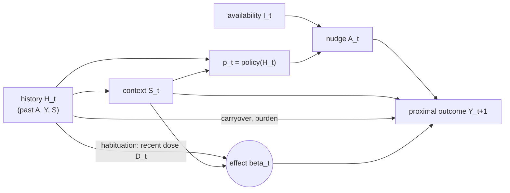
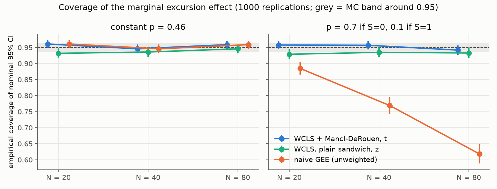
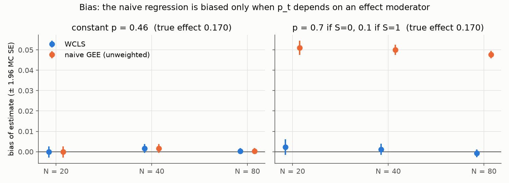
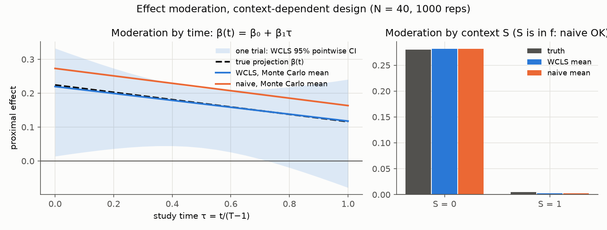
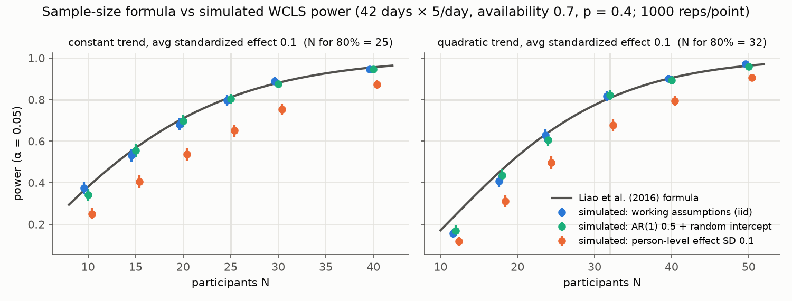
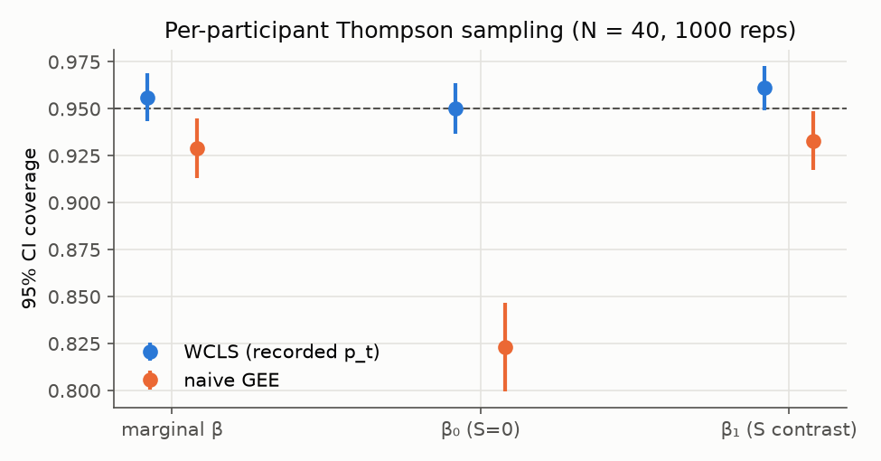

# jitai-lab

**Does this nudge work, right now, in this context?** A small, readable Python
toolkit to *design* and *analyze* micro-randomized trials (MRTs) for
just-in-time adaptive interventions (JITAIs):

* a simulator of MRT data with availability, time-varying context, context-dependent
  (or adaptive) randomization and a **known** causal excursion effect, plus
  nuisance dynamics (carryover, habituation, burden);
* the **weighted and centered least-squares (WCLS)** estimator of Boruvka et al.
  (2018) with a cluster-robust sandwich and the Mancl & DeRouen (2001)
  small-sample correction, and the naive GEE it is meant to replace;
* the **MRT sample-size formula** of Liao et al. (2016);
* simulation studies that try to break all of the above, with Monte Carlo
  standard errors, and the scripts that reproduce every number in this file.

Pure NumPy/SciPy, single-threaded, every study runs on a laptop in minutes.
See also [`docs/design_notes.md`](docs/design_notes.md): a cited summary of the
published JITAI frameworks (Nahum-Shani et al. 2018; Klasnja et al. 2015).

## Why I built this

<!-- TODO(Tommaso): dictate 3-4 lines in your own words -->

## Install

```bash
git clone <this repo> && cd jitai-lab
python -m venv .venv && source .venv/bin/activate
pip install -e ".[dev]"
pytest -q
python examples/quickstart.py
```

```python
from jitailab import MRTScenario, FixedPolicy, simulate_mrt, wcls, naive_gee, true_beta

sc = MRTScenario(policy=FixedPolicy(p_context0=0.7, p_context1=0.1))  # nudge rarely when "busy"
data = simulate_mrt(n=40, scenario=sc, seed=1)
fit = wcls(data, control=("1", "S", "time"), moderators=("1", "S"), ptilde=0.46)
fit.beta, fit.beta_ci()           # effect when S=0, and the S=1 vs S=0 contrast
```

## The setup

Participant $i$ is followed over decision points $t = 1, \dots, T$. At each one
we observe the history $H_t$, an availability indicator $I_t \in \{0,1\}$
(e.g. not driving), a context $S_t \subseteq H_t$; if available, a nudge
$A_t \in \{0,1\}$ is randomized with a known probability
$p_t(H_t) = \Pr(A_t = 1 \mid H_t, I_t = 1)$; then a proximal outcome
$Y_{t+1}$ is measured.



### Potential outcomes and the causal excursion effect

Let $Y_{t+1}(\bar a_t)$ be the outcome that would occur under the treatment
sequence $\bar a_t = (a_1, \dots, a_t)$. Following Boruvka et al. (2018), the
**causal excursion effect** of the nudge at time $t$, moderated by $S_t$, is

$$
\beta(t; s) \;=\; \mathbb{E}\!\left[\, Y_{t+1}(\bar A_{t-1}, 1) - Y_{t+1}(\bar A_{t-1}, 0) \;\middle|\; I_t = 1,\; S_t(\bar A_{t-1}) = s \right].
$$

It is an *excursion*: past nudges $\bar A_{t-1}$ follow the trial's own
randomization policy, and only the decision at $t$ deviates. So
$\beta(t;s)$ depends on the policy used in the trial (with habituation, a
policy that nudges more yields a smaller effect of the next nudge). With
consistency, positivity ($0 < p_t < 1$ when $I_t = 1$) and sequential
randomization (true by design in an MRT), it is identified as

$$
\beta(t;s) = \mathbb{E}\!\left[\, \mathbb{E}[Y_{t+1} \mid A_t = 1, H_t, I_t = 1] - \mathbb{E}[Y_{t+1} \mid A_t = 0, H_t, I_t = 1] \;\middle|\; I_t = 1, S_t = s \right].
$$

We model it linearly, $\beta(t; S_t) = f_t(S_t)^\top \beta$, e.g. $f_t = 1$
(marginal effect), $f_t = (1, S_t)^\top$ (context moderation) or
$f_t = (1, t/(T-1))^\top$ (change over the study).

### WCLS: weighted and centered least squares

Pick a reference probability $\tilde p_t(S_t) \in (0,1)$ that depends **only on
the moderators** (a constant is fine), a control working model $g_t(H_t)^\top
\alpha$, and the weight

$$
W_t = \left(\frac{\tilde p_t(S_t)}{p_t(H_t)}\right)^{A_t} \left(\frac{1 - \tilde p_t(S_t)}{1 - p_t(H_t)}\right)^{1 - A_t}.
$$

The WCLS estimator $\hat\theta = (\hat\alpha, \hat\beta)$ solves

$$
\sum_{i=1}^{N} \sum_{t=1}^{T} I_{it}\, W_{it} \Big( Y_{i,t+1} - g_{it}^\top \alpha - \big(A_{it} - \tilde p_t(S_{it})\big) f_{it}^\top \beta \Big)
\begin{pmatrix} g_{it} \\ \big(A_{it} - \tilde p_t(S_{it})\big) f_{it} \end{pmatrix} = 0 .
$$

Why the two ingredients:

* **weighting** turns the actual treatment distribution $p_t(H_t)$ into
  $\tilde p_t(S_t)$, which depends only on what is in $f_t$, so the
  estimand averages over everything *not* in $f_t$ with the natural weights;
* **centering** $A_t - \tilde p_t$ makes the treatment regressor orthogonal (in
  the weighted sense) to any function of $S_t$, so $\hat\beta$ is consistent
  **even if the control model $g_t^\top \alpha$ is wrong** (it only costs
  efficiency). Here the control model deliberately omits carryover, burden and
  the AR(1) noise.

If $f_t^\top\beta$ is itself misspecified, $\hat\beta$ converges to the weighted
projection

$$
\beta^\star = \arg\min_{b}\; \mathbb{E}\Big[ \sum_t I_t\, \tilde p_t (1-\tilde p_t)\, \big(\beta(t; S_t) - f_t^\top b\big)^2 \Big],
$$

which is exactly how `jitailab.true_beta` computes the ground truth (from the
per-person-time effects the simulator records, on a large population).

### Sandwich variance with small-sample correction

With $X_{it} = \big(g_{it}^\top,\; (A_{it} - \tilde p_{it}) f_{it}^\top\big)^\top$,
$B = \sum_i X_i^\top W_i X_i$ and residuals $e_i$,

$$
\widehat{\operatorname{Var}}(\hat\theta) = B^{-1} \Big( \sum_{i=1}^{N} X_i^\top W_i\, \tilde e_i\, \tilde e_i^\top W_i X_i \Big) B^{-1},
\qquad \tilde e_i = (I - H_{ii})^{-1} e_i,\quad H_{ii} = X_i B^{-1} X_i^\top W_i ,
$$

the bias-corrected sandwich of Mancl & DeRouen (2001); Boruvka et al. (2018)
likewise recommend a small-sample correction and $t$-based inference for MRTs.
`sandwich_wls` evaluates $(I - H_{ii})^{-1}$ with the Woodbury identity, so it
costs a $d \times d$ solve per participant instead of a $T \times T$ one (tested
against the explicit inverse). Confidence intervals use $t_{N - p - q}$ quantiles
($p = \dim f$, $q = \dim g$).

### The naive analysis and why it can be biased

The "obvious" analysis regresses $Y_{t+1}$ on $g_t$ and $A_t f_t$ without weights
or centering (GEE, working independence). With $f_t = 1$ and $g_t$ containing
$S_t$, its treatment coefficient converges, roughly, to a **variance-weighted**
average of the context-specific effects,

$$
\beta_{\text{naive}} \approx \frac{\sum_s \Pr(S = s)\, p(s)\,(1-p(s))\, \beta(s)}{\sum_s \Pr(S = s)\, p(s)\,(1-p(s))},
$$

instead of the plain average $\sum_s \Pr(S=s)\beta(s)$. The two coincide when $p$
does not depend on $s$ or when $\beta(s)$ does not. In the default scenario
($\Pr(S{=}1) = 0.4$, $p = 0.7$ vs $0.1$, $\beta(0) \approx 0.280$,
$\beta(1) \approx 0.005$) this predicts $\beta_{\text{naive}} \approx 0.219$ vs
the truth $0.170$, i.e. a bias of $\approx +0.049$; the simulation below finds
$+0.048$ to $+0.051$.

### Sample size (Liao et al. 2016)

Write the standardized proximal effect as $\beta(t) = Z_t^\top \beta$ (units of
the residual SD), with randomization probability $\rho_t$, expected availability
$\tau_t$, and $p = \dim Z_t$, $q$ = control-model dimension. The test of
$H_0: \beta = 0$ rejects when

$$
\frac{N - q - p}{p\,(N - q - 1)}\; N\,\hat\beta^\top \hat\Sigma_\beta^{-1} \hat\beta \;>\; F^{-1}_{p,\,N-q-p}(1-\alpha_0),
$$

and its power is approximated by a non-central $F_{p,\,N-q-p}$ with

$$
c_N = N\, \beta^\top \Big( \sum_{t=1}^{T} \tau_t\, \rho_t (1-\rho_t)\, Z_t Z_t^\top \Big) \beta .
$$

`mrt_sample_size` returns the smallest $N$ with power $\ge 1 - \beta_0$.
`constant_trend`, `linear_trend` and `quadratic_trend` (initial effect, day of
maximum, average effect) build $Z_t$ and $\beta$; the parametrization follows the
shapes in Liao et al. but is ours.

## Results (the verifier)

Everything below is reproduced by `bash scripts/reproduce.sh` (a few minutes,
single core). Raw numbers: [`results/*.json`](results). "± x" is one Monte Carlo
standard error. Default scenario: $T = 150$ decision points (30 days × 5),
availability 0.8, binary context with $\Pr(S{=}1) = 0.4$, true effect
$\beta_t = 0.4 - 0.3\,S_t - 0.1\,\tau_t - 0.05\,D_t$ (habituation through the
recent dose $D_t$), carryover 0.1, burden 0.02, random intercept SD 0.5, AR(1)
noise ($\phi = 0.3$). Estimand: marginal excursion effect with $\tilde p = 0.46$,
true value $0.1702 \pm 0.0001$. 1000 replications per cell.

### 1. WCLS is unbiased with nominal coverage; the naive analysis is not

| design | N | WCLS bias | WCLS coverage (MD, $t$) | WCLS coverage (plain, $z$) | naive bias | naive coverage |
|---|---|---|---|---|---|---|
| constant $p = 0.46$ | 20 | −0.0001 ± 0.0014 | 0.961 ± 0.006 | 0.932 ± 0.008 | −0.0001 ± 0.0014 | 0.961 ± 0.006 |
| | 40 | +0.0016 ± 0.0011 | 0.946 ± 0.007 | 0.936 ± 0.008 | +0.0016 ± 0.0011 | 0.946 ± 0.007 |
| | 80 | +0.0003 ± 0.0007 | 0.959 ± 0.006 | 0.946 ± 0.007 | +0.0003 ± 0.0007 | 0.959 ± 0.006 |
| $p = 0.7$ if $S{=}0$, $0.1$ if $S{=}1$ | 20 | +0.0022 ± 0.0019 | 0.958 ± 0.006 | 0.929 ± 0.008 | **+0.0510** ± 0.0018 (+30%) | 0.885 ± 0.010 |
| | 40 | +0.0012 ± 0.0014 | 0.957 ± 0.006 | 0.935 ± 0.008 | **+0.0500** ± 0.0013 (+29%) | 0.769 ± 0.013 |
| | 80 | −0.0008 ± 0.0010 | 0.942 ± 0.007 | 0.933 ± 0.008 | **+0.0477** ± 0.0009 (+28%) | 0.618 ± 0.015 |

With a constant $p = \tilde p$ the weights are all 1 and WCLS and the naive fit
coincide exactly. Under context-dependent randomization the naive estimate is
off by ~30% and its coverage *falls as N grows* (the bias does not shrink, the
CI does). The plain sandwich under-covers slightly (0.93); the Mancl–DeRouen
correction with $t_{N-p-q}$ brings it to 0.94–0.96, a little conservative at
$N = 20$.




### 2. Moderation over time and by context

Same context-dependent design, $N = 40$.

| model | coefficient | truth | WCLS bias | WCLS cov. | naive bias | naive cov. |
|---|---|---|---|---|---|---|
| $f_t = (1, \tau_t)$ | $\beta_0$ | 0.224 | −0.0047 ± 0.0028 | 0.954 | **+0.0488** ± 0.0023 | 0.902 |
| | $\beta_1$ (slope) | −0.108 | +0.0064 ± 0.0048 | 0.960 | −0.0013 ± 0.0040 | 0.953 |
| $f_t = (1, S_t)$ | $\beta_0$ ($S{=}0$) | 0.280 | +0.0018 ± 0.0014 | 0.949 | +0.0018 ± 0.0014 | 0.949 |
| | $\beta_1$ ($S$ contrast) | −0.276 | −0.0036 ± 0.0031 | 0.960 | −0.0035 ± 0.0031 | 0.961 |

Instructive: once the variable that drives randomization ($S$) is *in* $f_t$,
the naive fit is fine; leave it out (time model) and the intercept is biased.



### 3. The sample-size formula vs simulated power

42 days × 5 decision points/day (the HeartSteps layout described by Klasnja et
al. 2015), $\rho = 0.4$, availability 0.7 (our assumption), average standardized
effect 0.1. Formula: $N = 25$ (constant trend) and $N = 32$ (quadratic, 0 on
day 1, peak on day 28) for 80% power. Empirical power is the rejection rate of
the WCLS $F$ test (Mancl–DeRouen), 1000 trials per point, MC SE ≤ 0.016.

| trend | N | formula | sim: iid (working assumptions) | sim: AR(1) 0.5 + random intercept | sim: person-level effect SD 0.1 |
|---|---|---|---|---|---|
| constant | 10 | 0.380 | 0.374 | 0.342 | 0.251 |
| | 15 | 0.567 | 0.531 | 0.554 | 0.406 |
| | 20 | 0.710 | 0.680 | 0.697 | 0.538 |
| | **25** | **0.812** | **0.796** | **0.803** | **0.651** |
| | 30 | 0.881 | 0.889 | 0.875 | 0.754 |
| | 40 | 0.955 | 0.946 | 0.946 | 0.873 |
| quadratic | 12 | 0.246 | 0.156 | 0.170 | 0.118 |
| | 18 | 0.463 | 0.408 | 0.436 | 0.312 |
| | 24 | 0.642 | 0.629 | 0.607 | 0.497 |
| | **32** | **0.808** | **0.817** | **0.823** | **0.678** |
| | 40 | 0.904 | 0.901 | 0.894 | 0.794 |
| | 50 | 0.963 | 0.972 | 0.960 | 0.906 |

Type-I error at the formula's $N$ ($\beta = 0$): 0.038–0.054 across the six
trend × scenario cells (MC SE ≈ 0.007).

Reading: at and above the recommended $N$ the formula is accurate (within
~0.02) under its working assumptions, and also under within-person correlated
errors (with the total residual variance held at 1; centering makes the
treatment term uncorrelated with the error process). It is **optimistic at very
small $N$** (quadratic, $N = 12$: 0.25 nominal vs 0.16 simulated), and it does
**not** anticipate between-person heterogeneity of the effect itself: an effect
SD of 0.1 across people drops power at the recommended $N$ from ~0.80 to ~0.65–0.68.



### 4. Optional: adaptive (Thompson-sampling) randomization

Each participant runs their own Bayesian linear model and is nudged with
probability $\mathrm{clip}\big(\Pr(\text{effect in current context} > 0 \mid
\text{own history}), 0.1, 0.9\big)$. Average $p_t$: 0.75 when $S{=}0$, 0.53 when
$S{=}1$ (it learns that nudging when busy does little). Because $p_t$ is a
known function of each participant's own history and participants remain
independent, WCLS with the **recorded** $p_t$ keeps its guarantees; the truth is
recomputed under the adaptive policy ($N = 40$, 1000 reps):

| model | coefficient | truth | WCLS bias | WCLS cov. | naive bias | naive cov. |
|---|---|---|---|---|---|---|
| marginal | $\beta$ | 0.143 | +0.0020 ± 0.0013 | 0.956 | +0.0332 ± 0.0021 | 0.929 |
| $f = (1, S)$ | $\beta_0$ | 0.260 | +0.0022 ± 0.0018 | 0.950 | **+0.0814** ± 0.0026 | 0.823 |
| | $\beta_1$ | −0.291 | −0.0019 ± 0.0027 | 0.961 | −0.0577 ± 0.0033 | 0.933 |

Note the naive fit is now biased **even with $S$ in the model**: $p_t$ depends
on the participant's past outcomes (hence on their random intercept and
autocorrelated noise), not only on $S_t$.



## Reproduce

```bash
bash scripts/reproduce.sh          # all studies + figures (a few minutes, 1 core)
JITAILAB_QUICK=1 bash scripts/reproduce.sh   # 10x fewer reps, smoke test (as in CI)
```

| script | what |
|---|---|
| `scripts/study_coverage.py` | bias / coverage of WCLS vs naive, 2 designs × 3 N |
| `scripts/study_moderation.py` | time and context moderation |
| `scripts/study_power.py` | sample-size formula vs simulated power + type-I error |
| `scripts/study_thompson.py` | per-participant Thompson sampling |
| `scripts/make_figures.py` | all PNGs in `figures/` from `results/*.json` |

Seeds are fixed (`numpy.random.default_rng([design, N, rep])`), so reruns give
identical numbers on the same NumPy version.

## Limitations

* **Continuous proximal outcome, binary treatment, lag-1 only.** No delayed
  effects ($Y_{t+\Delta}$, $\Delta > 1$), no multi-level treatments, no binary
  outcomes (for those see the estimator of Qian et al. 2021).
* **$\tilde p$ is treated as known.** Estimating it from the data (e.g. a
  logistic model in $S_t$) adds an estimation step the sandwich should account
  for; that adjustment is not implemented here.
* **No missing outcomes**, no dropout; unavailable decision points are simply
  excluded, which is the definition of the estimand, not a missing-data method.
* **Stylized simulator.** One binary exogenous context, linear dynamics, effect
  sizes chosen for illustration. Nothing here is calibrated to real data, and
  no number here is a claim about any real intervention.
* **Sample-size formula** inherits Liao et al.'s working assumptions; as shown
  above it is optimistic at very small $N$ and when the effect varies across
  people. Use the formula for a first guess, then check by simulation.
* **Adaptive randomization** is covered only in the per-participant form.
  Algorithms that pool data across participants make participants dependent;
  valid inference then needs the theory for adaptively collected data (e.g.
  Zhang, Janson & Murphy 2021), which this package does not implement.
* The Mancl–DeRouen correction is slightly conservative at $N = 20$ here; other
  small-sample corrections are not compared.

## References

DOIs resolved on Crossref on 2026-10-30.

* Boruvka, A., Almirall, D., Witkiewitz, K., & Murphy, S. A. (2018). Assessing time-varying causal effect moderation in mobile health. *JASA*, 113(523), 1112–1121. https://doi.org/10.1080/01621459.2017.1305274
* Klasnja, P., Hekler, E. B., Shiffman, S., Boruvka, A., Almirall, D., Tewari, A., & Murphy, S. A. (2015). Microrandomized trials: An experimental design for developing just-in-time adaptive interventions. *Health Psychology*, 34(Suppl), 1220–1228. https://doi.org/10.1037/hea0000305
* Liao, P., Klasnja, P., Tewari, A., & Murphy, S. A. (2016). Sample size calculations for micro-randomized trials in mHealth. *Statistics in Medicine*, 35(12), 1944–1971. https://doi.org/10.1002/sim.6847
* Liao, P., Greenewald, K., Klasnja, P., & Murphy, S. (2020). Personalized HeartSteps: A reinforcement learning algorithm for optimizing physical activity. *Proc. ACM IMWUT*, 4(1), 1–22. https://doi.org/10.1145/3381007
* Mancl, L. A., & DeRouen, T. A. (2001). A covariance estimator for GEE with improved small-sample properties. *Biometrics*, 57(1), 126–134. https://doi.org/10.1111/j.0006-341X.2001.00126.x
* Nahum-Shani, I., Smith, S. N., Spring, B. J., Collins, L. M., Witkiewitz, K., Tewari, A., & Murphy, S. A. (2018). Just-in-time adaptive interventions (JITAIs) in mobile health: Key components and design principles for ongoing health behavior support. *Annals of Behavioral Medicine*, 52(6), 446–462. https://doi.org/10.1007/s12160-016-9830-8
* Qian, T., Yoo, H., Klasnja, P., Almirall, D., & Murphy, S. A. (2021). Estimating time-varying causal excursion effects in mobile health with binary outcomes. *Biometrika*, 108(3), 507–527. https://doi.org/10.1093/biomet/asaa070
* Zhang, K. W., Janson, L., & Murphy, S. A. (2021). Statistical inference with M-estimators on adaptively collected data. *NeurIPS 2021*. arXiv:2104.14074.

## License

MIT © 2026 Tommaso Maggiolo. See [`CITATION.cff`](CITATION.cff) to cite.
